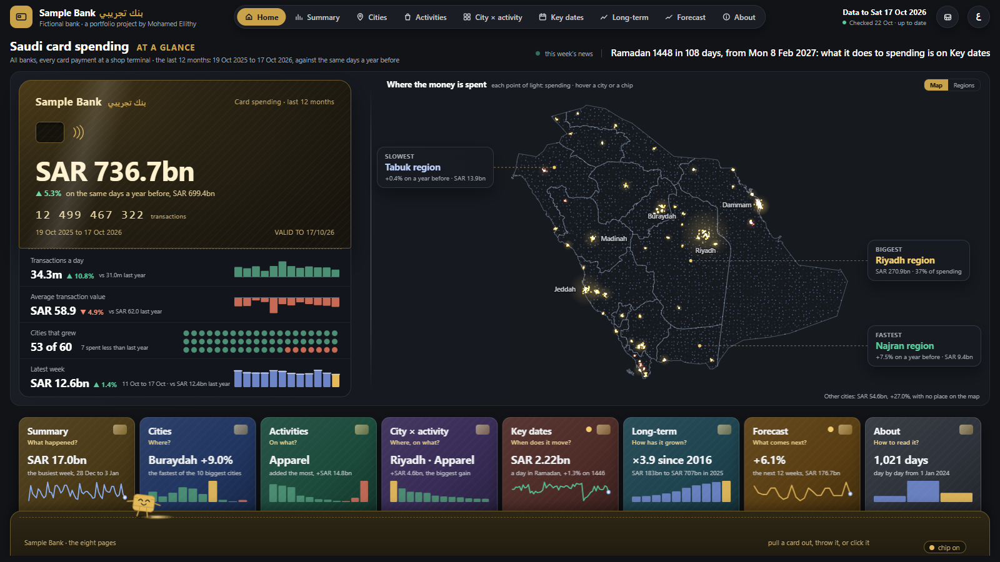
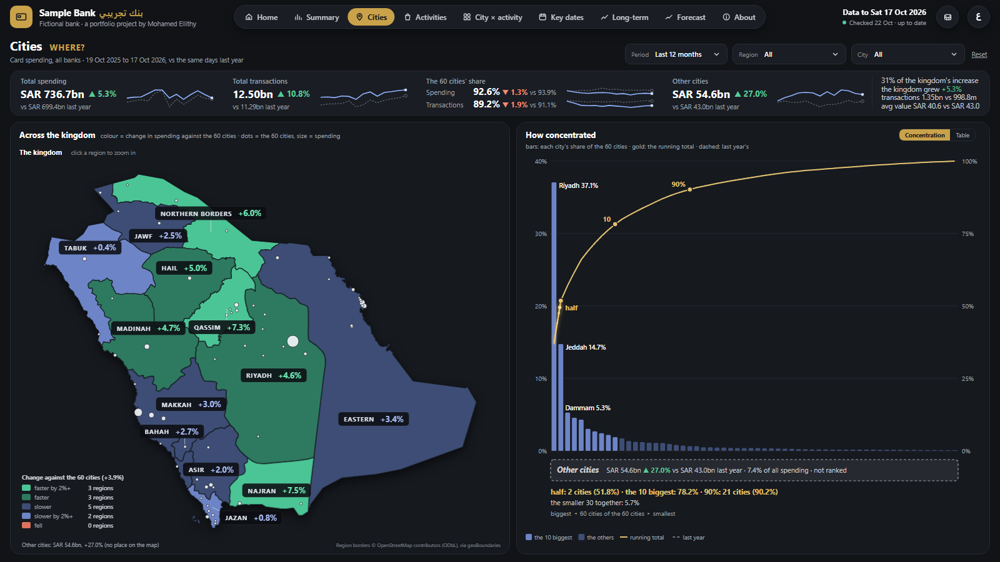
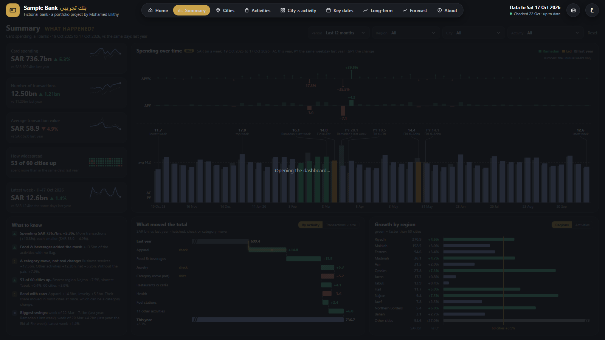
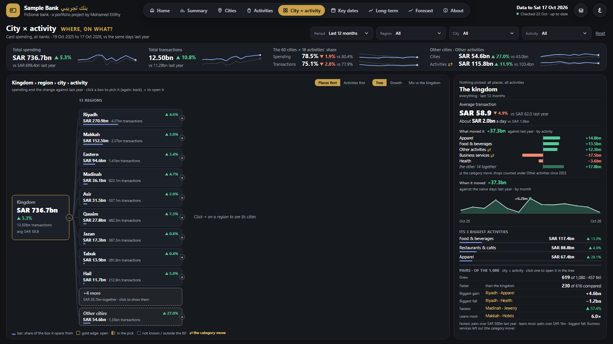
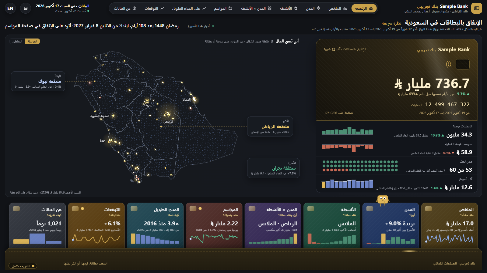
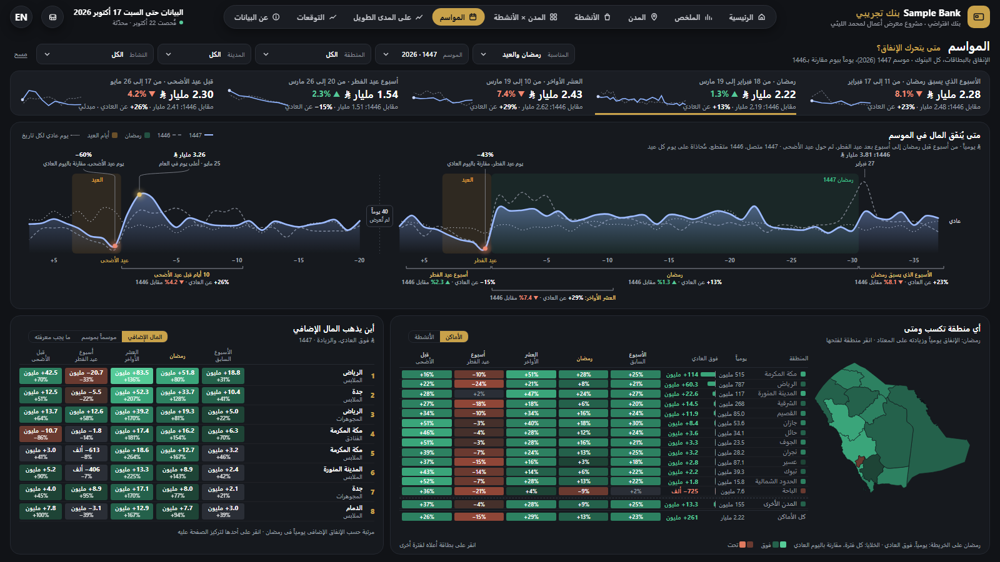

# Saudi Consumer Spending Intelligence

Card spending in Saudi Arabia by city, by activity and by day, from the Saudi Central Bank's (SAMA) open data.

**Open the dashboard:** [mellithyy.github.io/saudi-consumer-spending-intelligence](https://mellithyy.github.io/saudi-consumer-spending-intelligence/)

Nine pages in English and Arabic, with their filters. The Arabic pages read right to left, charts included. It opens in any
browser, phones included (turn the phone sideways).

## What it shows
The 12 months to 17 October 2026, against the same days a year before:
- SAR 736.7 billion was paid by card, up 5.3%: about 397 card payments a second.
- The number of payments grew 10.8% while the average payment fell 4.9% (to SAR 58.9): people paid by card more often,
  and the extra payments were mostly small ones.
- 53 of the 60 cities grew. Najran was the fastest region (+7.5%) and Buraydah the fastest of the 10 biggest cities (+9.0%).
  Riyadh region alone holds 37% of all spending.
- Apparel added the most of any activity (+SAR 14.8 billion), and Riyadh's apparel shops were the biggest gain of any city
  and activity pair (+SAR 4.6 billion).
- Ramadan 1447: SAR 2.22 billion a day, up 1.3% a day on Ramadan 1446. A payday spends about 1.4 times a normal day.
- Since 2016 the yearly total has grown 3.9 times, from SAR 183 billion to SAR 707 billion in 2025. The next 12 weeks are
  forecast at SAR 176.7 billion, 6.1% above the same weeks last year.

## The pages
| Page | The question it answers |
|---|---|
| Home | How much was paid by card in the last 12 months, where, and how fast is it growing? A wallet of cards opens each page |
| Summary | What happened: spending week by week against last year, what moved the total, and growth by region and activity |
| Cities | Where: the 13 regions and 60 cities on a map, how concentrated spending is, and every city in one table |
| Activities | On what: each activity's size and change, why it changed (more payments or bigger ones) and when each is busiest |
| City × activity | Where and on what: a tree from the kingdom down to each region, city and activity (click a box to open it), and each pair's growth |
| Key dates | When: Ramadan and Eid, paydays and National Day, day by day against a normal day and against the year before |
| Long-term | Over the years: the market since 2016, its regions, cities and activities, each from where its data starts |
| Forecast | What comes next: the next 12 weeks and months with a range, the seasons ahead, and how far to trust it |
| About | Where the numbers come from, what each one means, and the checks and limits |

| | |
|---|---|
|  |  |
|  |  |
|  | |

## How it was built
- **Data.** SAMA's Open Data Portal: daily numbers since 1 January 2024 for 60 cities in 13 regions and 19 activities
  (about 3.8 million numbers, downloaded from the portal's web form); the monthly table for 2016 to 2023; and the weekly
  PDF reports SAMA has published since June 2020.
- **Checks on the data.** The daily data, added up into Sunday-to-Saturday weeks, equals SAMA's weekly reports for every city
  within rounding. One week (24 to 30 March 2024) is short in the report, about half of Saturday 30 March is missing, so the
  daily data is used there. Every day, the activities add up to the total and the cities to the kingdom.
- **Model.** A star schema built in SQL (DuckDB). A refresh script reruns every step behind the checks: a check that fails
  stops the run, and the last approved tables stay in use.
- **Forecast.** Simple methods, standard models (SARIMAX, Holt-Winters, Prophet) and machine learning (gradient boosting) were
  each made to forecast 12 weeks from 17 past dates without seeing them. The way that missed least is kept, and its range is
  sized by its own past misses.
- **Dashboard.** The first version was a Power BI report (DAX, Deneb). This version is a web page built on the same model:
  every chart is drawn in SVG by its page's own code, so each one can be clicked, filtered and read in either language.
- **Checks on the pages.** Every page's numbers are compared with SQL on the database at several data ends, every filter
  choice is tried, and planted mistakes must be caught. Every page is also measured for text over text, cut words and English
  left in the Arabic, and the whole dashboard is walked through at three window sizes.

Tools: Python (pandas, requests), SQL (DuckDB), JavaScript and SVG, Power BI for the first version, headless Microsoft Edge
for the checks.

"Sample Bank" in the dashboard is a fictional bank: the numbers are SAMA's as published, the analysis is the author's.
The source code, the data and the Power BI files are kept private, and can be walked through in an interview.

## Rights
© 2026 Mohamed Ellithy. All rights reserved: the dashboard can be viewed and linked to, but not copied, reused or re-hosted
(see [LICENSE](LICENSE)). Data: Saudi Central Bank (SAMA) Open Data Portal.

## Author
Mohamed Ellithy, Data Analyst, Al Khobar · [LinkedIn](https://www.linkedin.com/in/mohamed-el-lithy/)
